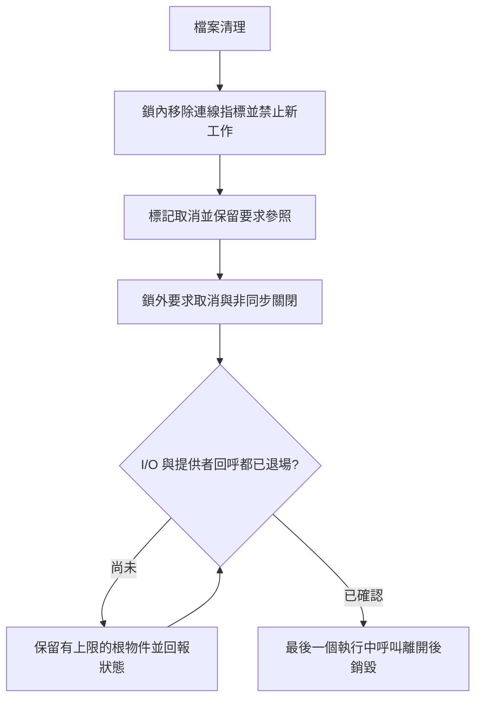

# 從離線 LDAC 到 Windows 原生傳輸：開發教學

這份文件記錄 `open-ldac-windows` 如何拆解需求、選擇架構、建立測試，
以及如何處理實際遇到的核心當機。適合想讀懂專案、重現離線工具，
或準備參與 Windows 驅動開發的人。

截至 2026-11-01，已完成離線編碼、原生傳輸原始碼與建置，以及隔離虛擬機中的
合成提供者基準／標準 Driver Verifier 測試。**完整 AVDTP 串流、Windows 音訊端點、
真實 MediaTek／WH-1000XM6 播放與耗電驗證仍未完成。**

本文件的核心測試結果對應程式修正 `36bc35f`。後續文件提交不代表重新驗證了另一個驅動二進位。
原始開發時間線見[開發紀錄與心得](DEVELOPMENT_JOURNAL.zh-TW.md)，
可公開的實測摘要見[核心驗證紀錄](validation/KERNEL_LAB_2026-11-01.md)。

## 閱讀順序

1. [需求與架構](#1-先把需求拆成可以驗證的階段)
2. [重現離線編碼](#2-從不需要安裝驅動的離線工具開始)
3. [建立 Windows 原生傳輸](#3-建立原生傳輸與可重現的建置)
4. [取消與資源生命週期](#4-取消與關閉為什麼比傳送資料更難)
5. [虛擬機與簽章](#5-建立可以復原的核心測試環境)
6. [實際當機除錯](#6-實例一個少了大括號的巨集如何造成核心當機)
7. [Driver Verifier 與證據](#7-如何判斷-verifier-真的測到了驅動)
8. [音質、碼率與耗電](#8-音質優先如何落實到設計)
9. [後續開發與提交](#9-下一位開發者可以從哪裡接手)

## 1. 先把需求拆成可以驗證的階段

目標是在現有內建藍牙上，透過 Windows 原生堆疊把 LDAC 音訊送到耳機。
開發初期以 MediaTek 藍牙與 Sony WH-1000XM6 為目標，但尚不能宣稱已相容。

「有編碼器」與「Windows 可以把它當成聲音輸出」之間，至少還有協定、
核心傳輸、音訊端點、簽章及安裝復原等工作。因此使用以下里程碑：

| 階段 | 要完成的內容 | 可以用什麼證據確認 |
| --- | --- | --- |
| M0 | 離線 LDAC、封包原語、品質策略 | 編碼與輸入／輸出測試 |
| M1 | KMDF／L2CAP 診斷傳輸 | WDK 建置、核心測試、真實提供者測試 |
| M2 | 完整 AVDTP 狀態機與耳機串流 | 耳機接受設定、媒體封包與播放紀錄 |
| M3 | Windows PCM 音訊端點與使用者模式服務 | 一般應用程式可選取端點並播放 |
| M4 | 筆電品質、穩定性與電力驗證 | 實際量測、休眠恢復及共存測試 |
| M5 | 發行簽章、安裝與復原 | 可重現套件、乾淨安裝／解除安裝／回復 |

### 分層的理由

```text
一般 Windows 應用程式
  → Windows 音訊端點                    [尚待實作]
  → 事件驅動的使用者模式編碼服務         [尚待實作]
  → LDAC 編碼與 RTP／LDAC 封包           [已有離線核心]
  → AVDTP 協商與串流狀態機              [只有部分原語]
  → KMDF 藍牙設定檔傳輸驅動             [驗證中]
  → Microsoft 藍牙堆疊與現有無線電驅動
  → 內建藍牙與耳機                      [實機驗證待辦]
```

壓縮與浮點運算放在使用者模式；核心只負責傳輸、取消、生命週期及事件。
這能縮小必須在核心環境除錯的範圍。一般 RFCOMM socket 也不能直接代替 A2DP 的媒體傳輸。
相關依據與端點選型問題放在[架構決策](NATIVE_ARCHITECTURE.md)。

### 先處理來源與授權

本專案整合固定版本的 AOSP／Sony `libldac`，沒有重新發明 LDAC 編碼器，
也沒有包含 Alternative A2DP Driver 的專有程式碼或二進位。

| 內容 | 來源／授權 | 查閱位置 |
| --- | --- | --- |
| LDAC 編碼器 | AOSP／Sony，Apache-2.0 與原 NOTICE | [上游版本](../vendor/libldac/UPSTREAM.md) |
| 原生傳輸衍生碼 | Microsoft bthecho，MS-PL | [來源與修改](../driver/UPSTREAM.md) |
| 原創核心、生命週期模型、工具與測試 | Apache-2.0 | [LICENSE](../LICENSE) |

保留來源提交、授權、NOTICE 與修改範圍，是可重現開源專案的一部分。
開源授權也不等於已取得產品認證；專案沒有宣稱 Sony 認證或量產資格。

## 2. 從不需要安裝驅動的離線工具開始

先讓 WAV → LDAC 的路徑可以獨立測試，能避免把編碼錯誤、封包錯誤與核心錯誤混在一起。
下面的命令只建置和執行使用者模式工具，不會安裝驅動。

### 準備與建置

需要 Git、CMake 3.20 以上、C11 編譯器與 Python 3；Windows 使用 MSVC 時，
請在已設定 C++ 工具環境的命令列執行。

```powershell
git clone https://github.com/peianchen/open-ldac-windows.git
cd open-ldac-windows
git switch native-transport-m1

cmake -S . -B build
cmake --build build --config Release
ctest --test-dir build -C Release --output-on-failure
python tests/integration.py build/Release/wldac_cli.exe
```

以上執行檔位置對應 Windows 多組態建置。Linux 通常使用 `build/wldac_cli`；
Windows 的單組態產生器也可能沒有 `Release/` 子目錄。
`native-transport-m1` 是目前開發分支；若要讀本次核心修正的精確程式版本，使用 `36bc35f`。

也可以使用專案已驗證過的可攜式 Zig 0.14.1：

```powershell
./tools/build-zig.ps1 -Zig C:/tools/zig/zig.exe
python tests/integration.py build/wldac_cli.exe
```

Zig 路徑需換成自己的安裝位置。這是離線使用者模式建置方式，不是 WDK 驅動建置的替代品。

### 編碼與手動碼率

以下以 Zig 版本的輸出位置示範；CMake 多組態建置請加上 `Release/`。
輸入必須是工具支援的立體聲 WAV，輸出檔案須使用尚不存在的新名稱。

```powershell
./build/wldac_cli.exe bitrates 48000
./build/wldac_cli.exe encode input-48k.wav output-hq.ldac
./build/wldac_cli.exe encode input-48k.wav output-990.ldac --bitrate 990
./build/wldac_cli.exe encode input-44k1.wav output-909.ldac --bitrate 909
```

| 來源取樣率 | HQ | SQ | MQ |
| --- | ---: | ---: | ---: |
| 48／96 kHz | 990 kbps | 660 kbps | 330 kbps |
| 44.1／88.2 kHz | 909 kbps | 606 kbps | 303 kbps |

沒有指定選項時預設 HQ。不能把 44.1 kHz 的來源硬套成 990 kbps；API 會驗證取樣率與碼率的配對。
目前是離線 CLI 與編碼器 API 的功能，尚未完成耳機即時控制介面。
支援格式、限制與模式切換行為見[碼率控制](BITRATE_CONTROL.md)。

### 離線驗證應該檢查什麼

- WAV 格式、長度、聲道與取樣率是否正確，截斷輸入是否被拒絕。
- 編碼輸出能否逐幀解析，標頭、長度及取樣率 ID 是否合理。
- RTP 序號／時間戳回捲、MTU 與封包邊界是否受限。
- 現有輸入與輸出檔案是否受到保護，避免測試覆寫資料。
- 品質模式切換是否序列化，後續輸出幀是否對應指定模式。

這些測試可以發現程式問題，但沒有執行解碼／耳機播放／聽感比較，就不能寫成音質實測。

## 3. 建立原生傳輸與可重現的建置

### 找出最小必要的核心工作

目前診斷傳輸使用公開的 Bluetooth profile DDIs。一般檔案開啟與狀態查詢不會建立藍牙通道；
必須明確要求連線，才會使用綁定裝置的位址與 AVDTP PSM `0x0019`。
不讓一般使用者指定任意遠端位址或 PSM，也不綁定所有藍牙裝置。

核心介面採版本化、沒有使用者指標的訊息，並限制存取權限、檔案數、
連線根物件數、封包長度及同時送出的傳輸數。
檔案與保留中的連線根物件各自最多兩個，資料傳輸槽最多八個。

### WDK 建置

驅動使用固定的官方 SDK／WDK NuGet `10.0.26100.6584`，設定見
[`packages.config`](../driver/packages.config)。需要 Visual Studio C++／MSBuild 與對應的 WDK 整合工具。
下列命令只建置未簽章套件：

```powershell
nuget restore driver/packages.config -PackagesDirectory driver/.packages -NonInteractive
msbuild driver/OpenLdacTransport.vcxproj /m /p:Configuration=Release /p:Platform=x64 /p:SignMode=Off
msbuild driver/OpenLdacKernelLab.vcxproj /m /p:Configuration=Release /p:Platform=x64 /p:SignMode=Off /p:RunCodeAnalysis=true
```

第一個專案是原生傳輸；第二個是隔離 VM 用的合成提供者測試驅動。
兩者用途不同，測試驅動沒有實體藍牙，也沒有音訊端點。
CI 的完整工具設定是較可靠的重現入口：

- [離線核心與主機模型 CI](../.github/workflows/ci.yml)
- [原生傳輸建置、分析與套件檢查](../.github/workflows/native-driver.yml)
- [合成核心測試驅動建置與符號封裝](../.github/workflows/kernel-lab.yml)

### 這次遇到的建置問題

| 問題 | 診斷與處理方式 | 學到什麼 |
| --- | --- | --- |
| x86 MSBuild 找不到適用的 WDK 工具 | 明確使用 x64 MSBuild 與工具路徑 | 執行建置工具的架構也要固定 |
| 核心 ABI 標頭引入使用者模式 CRT 型別 | 依核心／使用者模式選擇對應型別並檢查 ABI 大小 | 共用標頭不代表可以共用全部相依性 |
| MSVC 無法接受上游 GNU／POSIX 相容部分 | 把相容設定限制在編碼器 target，保留固定上游來源 | 避免為了編譯而任意修改上游 |
| 測試控制裝置連結缺少 SDDL 符號 | 補上 `Wdmsec.lib` | 編譯通過仍可能在連結階段失敗 |
| SYS 有除錯資訊但 artifact 沒有 PDB | 同次建置保留 SYS、PDB、分析紀錄與雜湊 | 當機前就要準備精確的符號 |

CI 綠燈代表該次建置和檢查通過。它不代表驅動已載入，也不代表 XM6 已收到音訊。

## 4. 取消與關閉為什麼比傳送資料更難

使用者關掉檔案時，OPEN 可能仍在送出、讀取仍在等待，提供者也可能稍後才釋放回呼。
若立即刪除連線物件，稍後執行的回呼就可能存取已釋放記憶體。
若一直同步等待，關閉流程又可能卡住。

### 用持有權描述物件何時能刪除

本專案把可獨立存活的連線根物件，與檔案物件分開。每種非同步使用都有明確持有權：

| 持有者 | 取得時機 | 可以放掉的時機 |
| --- | --- | --- |
| 檔案擁有者 | 建立連線根物件 | 清理時移除檔案中的連線指標 |
| OPEN | 送出開啟要求前 | 真正完成，或已知送出失敗 |
| 提供者回呼 | `IndicationAddReference` | `IndicationReleaseReference` |
| 資料 I/O | 配置傳輸槽並準備送出 | 真正完成，或已知格式化／送出失敗 |
| CLOSE | 重用預留關閉要求前 | 真正完成，或已知送出失敗 |
| 執行中的呼叫 | 借用連線、進入回呼或完成函式 | 該次呼叫最後一次存取後 |

這不是六種互斥狀態；同一物件可以同時被多個持有者使用。
只有所有必要持有權都結束，才可以銷毀根物件。



圖中的回到判斷代表收到完成／回呼事件後重新判斷，不是背景輪詢或忙碌迴圈。
實作與詳細條件見[生命週期設計](LIFETIME.md)。

### 取消呼叫回傳，不等於要求已經完成

取消可能與送出互相交錯：

1. 清理流程標記取消，但要求尚未送出。
2. 另一個執行緒把要求送出。
3. 如果只有送出前檢查，要求可能錯過取消。

因此送出前後都檢查取消意圖，跨越 Send 與可能的同步完成時保留要求參照。
資料緩衝區也必須等真正完成後才能釋放。
使用者模式的 OVERLAPPED 緩衝區遵守相同原則：要求取消後，仍須等它退場。

### CLOSE 失敗時如何處理

關閉要求與描述子在 OPEN 前預留，減少清理時才配置失敗的機會。
本地送出失敗最多立即嘗試兩次；不建立無限背景重試。
但 CLOSE 成功或失敗都不代替提供者的 ReleaseReference。

若提供者始終不退場，就保留最多兩個不確定的根物件，讓後續連線回報忙碌，
而不是等一段時間就強制釋放。這限制了成長，卻不是保證恢復：
保留物件仍可能持有裝置或電源相關資源，之後必須做實機恢復與耗電測試。

### 遠端中斷與移除

遠端中斷使用公開的 `CloseNow` 回應，避免檔案清理再送重複 CLOSE。
硬體移除則標記 removed、只停止本地 target 一次，並取消競爭中的要求。
主機模型曾抓到移除路徑仍送 CLOSE 的問題，修正後才繼續核心測試。

## 5. 建立可以復原的核心測試環境

核心錯誤可能讓整個測試 Windows 當機，因此先建立隔離 VM。
本次使用 VirtualBox 與官方 Windows Enterprise Evaluation；評估版有期限，
日後長期使用 VM 時仍需合適授權。帳號密碼、無人值守安裝檔與原始 dump 都保持私有。

### 本次實驗室配置

- x64 Windows 客體、4 vCPU、4 GiB 記憶體、動態 80 GiB 磁碟。
- CPU 執行上限 100%，避免額外的節流時序影響。
- USB Tablet 配合虛擬 OHCI；沒有擷取實體 USB 藍牙裝置。
- NAT 網路；未啟用共用資料夾、剪貼簿、拖放或客體音效。
- Guest Additions 與客體管理員執行能力經實際確認。
- 關機後建立乾淨快照，再變更客體測試簽章設定。

這只是本次可運作的配置，不是所有筆電的最佳效能建議。
主機 hypervisor 使 VirtualBox 使用 NEM；本次沒有停用日用 Windows 的 VBS／Hyper-V 等設定。

### 實際環境問題如何排查

| 現象 | 這次查到的事實 | 處理方式與界限 |
| --- | --- | --- |
| 安裝 Guest Additions 時要求管理員，UAC 只有「否」 | 原客體帳號不在 Administrators | 保留原 VM，另建使用正式 Administrator 無人值守路徑的測試 VM；重新驗證實際權限 |
| 滑鼠點擊不穩定 | 設為 USB Tablet，但虛擬 USB 控制器全部關閉 | 啟用虛擬 OHCI；使用者確認游標與點擊恢復 |
| 暖重新啟動黑畫面 | 本次環境能用冷啟動恢復，但原因尚未完全確認 | 正常關機後冷啟動；不宣稱黑畫面根因已修好 |
| 裝完又進安裝畫面 | 安裝媒體仍掛載 | 退出安裝媒體，設為硬碟優先 |
| 簽章工具啟動失敗 | 官方 SDK 工具的並存組件相依檔不完整 | 依 manifest 補齊 AppxPackaging／OpcServices 等相依閉包，先測工具能否啟動 |

檢查帳號名稱並不足夠，要確認實際群組與提升後的執行能力。
「已安裝 Guest Additions」也要以 GuestControl 確實可執行／傳檔來確認。

### 簽章與復原順序

1. 確認是指定測試 VM，驗證管理員、代理與正常關機能力。
2. 驗證 CI artifact 的來源、SYS／PDB 雜湊與符號 GUID／age。
3. 建立尚無專案憑證、服務、測試模式或 Verifier 的乾淨快照。
4. 只在客體建立測試憑證／信任、配置必要的客體啟動設定。
5. 使用嵌入式測試簽章的 VM-only SYS，驗證簽章後冷啟動。
6. 註冊 demand-start 測試服務，先跑基準，再跑指定驅動的 Verifier。
7. 保存原始證據；測試結束後卸載服務、清除未來的 Verifier 設定並正常關機。

本次客體的虛擬 Secure Boot 在快照之後才停用，日用主機的 Secure Boot 沒有變更。
這是隔離實驗室的測試路徑，不是提供使用者繞過正式發行簽章的安裝方式。
正式傳輸套件的 CAT／INF 驗證、發行簽章與安裝復原仍是後續工作。

## 6. 實例：一個少了大括號的巨集如何造成核心當機

這次第一次真實 WDF 基準測試沒有通過。服務成功載入後，執行連線測試便觸發
`0x3B SYSTEM_SERVICE_EXCEPTION`，例外為 `0xC0000005`。
之前主機模型與 WDK 靜態分析都通過，仍沒有抓到這個測試環境初始化錯誤。

### 先取得可判斷的證據

最初 Windows 沒有成功產生當機轉存檔，系統記錄 volmgr 161。
因此補上客體專用轉存空間與虛擬 COM 核心除錯，再重現同一測試。
Microsoft KD 使用精確 PDB 連線到客體；日用主機本身沒有啟用核心除錯。

實際呼叫堆疊縮寫如下：

```text
OpenLdacKernelLab!memset
OpenLdacKernelLab!LabReuseBrb
OpenLdacKernelLab!OlConnectChannel
OpenLdacKernelLab!OlEvtDeviceIoControl
OpenLdacKernelLab!LabControl
```

記憶體清零的目的位址是 NULL。再用 WDF 除錯延伸檢查要求，發現：

| 檢查項目 | 實際觀察 |
| --- | --- |
| 要求所屬裝置 | 主測試裝置 |
| 要求內真正配置的 context | `LAB_PORT_REQUEST`，8 bytes |
| 主傳輸程式預期的 context | `OL_REQUEST_CONTEXT`，512 bytes |
| WDF IFR | 記錄取得 `OL_REQUEST_CONTEXT` 時發生類型不符 |

### 出錯的程式

位於 [`tests/kernel/lab_driver.c`](../tests/kernel/lab_driver.c) 的初始化分支原本寫成：

```c
if (Main) {
    /* 主裝置的其他初始化 */
    WDF_OBJECT_ATTRIBUTES_INIT_CONTEXT_TYPE(&requests, OL_REQUEST_CONTEXT);
} else WDF_OBJECT_ATTRIBUTES_INIT_CONTEXT_TYPE(&requests, LAB_PORT_REQUEST);
```

問題在於 WDK 的 `WDF_OBJECT_ATTRIBUTES_INIT_CONTEXT_TYPE` 展開為兩個敘述：
先初始化 attributes，再設定 ContextTypeInfo。沒有大括號的 else 只包住第一個敘述，
第二個敘述會無條件執行，連 Main 分支也被改成 `LAB_PORT_REQUEST`。

修正為：

```c
if (Main) {
    /* 主裝置的其他初始化 */
    WDF_OBJECT_ATTRIBUTES_INIT_CONTEXT_TYPE(&requests, OL_REQUEST_CONTEXT);
} else {
    WDF_OBJECT_ATTRIBUTES_INIT_CONTEXT_TYPE(&requests, LAB_PORT_REQUEST);
}
```

這個修正針對合成核心測試驅動的初始化，不是把整個真實藍牙傳輸重新寫過。
[修正提交](https://github.com/peianchen/open-ldac-windows/commit/36bc35fd0ef8563af7a7a05f2c55835d18553522)
保留了原因與範圍。

### 除錯命令要能回答具體問題

以下是在**已連線至指定測試客體、且已停在當機位置**的 KD 中使用的概念順序。
`<...>` 必須換成該次實際取得的位址或控制代碼；不可沿用別次當機的數值。

```text
.cxr <本次例外的 context 位址>
kv
ln <本次故障位址>
!wdfkd.wdfrequest <本次要求控制代碼>
!wdfkd.wdfhandle <本次要求控制代碼>
!wdfkd.wdflogdump OpenLdacKernelLab
.dump /m <私有資料夾中的新 dump 檔名>
```

`kv` 用來看呼叫關係，`wdfhandle` 用來核對 context；不是只看一個藍畫面錯誤碼就猜原因。
本次成功保存小型核心 dump。完整 dump 與除錯紀錄可能包含敏感資料，沒有隨教學公開。
當機前部分 JSON 因快取尚未落盤而成為 NUL 檔，也被標為無效，沒有拿來當通過證據。

### 修完後回到同一條路徑

修正版通過相同建置 CI，再於同一隔離環境執行相同 runner：
363 項檢查通過、33 次回呼建立／釋放、33 個連線根物件銷毀，並完成正常卸載。
這樣才能把「改了程式」與「原本失敗的案例已經恢復」連起來。

## 7. 如何判斷 Verifier 真的測到了驅動

本次使用只選擇 `OpenLdacKernelLab.sys` 的 standard oneboot profile。
先通過基準與正常卸載，再配置 Verifier、正常關機並冷啟動。
沒有在日用主機啟用 Verifier，也沒有選取所有驅動。

| 證據 | 能回答的問題 |
| --- | --- |
| `verifier /querysettings` | 預定啟用哪些旗標、選擇哪些驅動與開機模式 |
| 新的開機時間 | 設定後是否真的經過一次啟動 |
| `verifier /query` | 目前執行中的 Verifier 是否列出目標模組與旗標 |
| runner 輸出 | 測試案例是否完成，回呼與根物件計數為何 |
| 服務狀態與 runtime 載入／卸載次數 | 驅動是否實際載入，並能卸載 |
| 當機、WDF 與系統紀錄 | 是否有必須分析的違規或不完整測試 |

本次標準 profile 的實際旗標為 `0x001209bb`；設定清單包含 WDF 規則類別 34。
runtime 列出目標模組，測試後載入 1 次、卸載 1 次。
在此 profile 下相同 363 項合成案例通過。

需要保留的限制：

- 主機 shim 模擬 API，不代表核心 IRQL 或真實平行排程。
- VM 使用真實 WDF，但下層 Bluetooth 提供者仍是本專案的合成實作。
- standard profile 沒有選擇低資源模擬、強制 pending I/O 或同步延遲模糊測試。
- 此次集區統計為零，不能單憑這些數字宣稱所有 WDF 內部配置都已追蹤、沒有洩漏。
- 這些案例沒有驗證實體 BthPort、真正 PnP／休眠恢復或 XM6 音訊。

完整驗證仍須依[核心案例矩陣](KERNEL_TEST_MATRIX.md)逐項補齊。
正式結果與 CI 連結集中在[本次驗證報告](validation/KERNEL_LAB_2026-11-01.md)。

## 8. 音質優先如何落實到設計

本專案的優先順序是音質優先，同時避免筆電不必要的工作。
目前的預設 HQ 不會因為拔掉充電器而自動降低。

### 品質決策

- 保留相容的 44.1／48 kHz 來源，不為了顯示更高數字而強制升頻。
- 88.2／96 kHz 需要明確選擇；升頻本身不是聽感改善證據。
- 允許使用者明確指定合法碼率，並顯示實際編碼模式。
- 未來網路／RF 不穩定時，要回報實際狀態，不能暗中把品質優先改成省電模式。

### 耗電決策

即時路徑應採事件等待、有限緩衝、背壓與必要的批次處理；沒有播放者時停止編碼。
不以忙碌迴圈或修改全系統 1 ms 計時器作為預設排程方式。
錯誤時有上限地保留資源雖然比 use-after-free 安全，仍須量測是否妨礙裝置休眠。

離線 CPU 比較可以用以下方式重現：

```powershell
python tools/benchmark.py build/wldac_cli.exe --output build/cpu-report.json
```

它量的是編碼 CPU 時間，不是瓦數、電池時數、藍牙重傳，也不是耳機音質。
將來需要在相同來源、音量、RF 距離、Wi-Fi 情況、電源模式與測試長度下比較，
保留原始量測、重複次數與變異，不先寫出沒有量過的省電百分比。
細節見[音質與耗電計畫](POWER_AND_QUALITY.md)。

## 9. 下一位開發者可以從哪裡接手

| 想處理的工作 | 入口 | 接受條件 |
| --- | --- | --- |
| 編碼、碼率與格式處理 | `src/wldac.c`、`tests/core_tests.c`、`tests/integration.py` | 幀與輸入保護測試通過 |
| AVDTP 與媒體封包 | `src/avdtp.c`、`include/` | 協定邊界、狀態與拒絕路徑明確 |
| 生命週期 | `src/lifetime.c`、`tests/lifetime_tests.c` | 真正失敗案例、模型／適用的 sanitizer 測試 |
| 原生要求轉送與取消 | `driver/transport/`、`tests/native/` | 實際函式測試與核心回歸測試 |
| 核心故障測試 | `tests/kernel/`、`docs/KERNEL_TEST_MATRIX.md` | 記錄實際觸發的故障點與 active Verifier 證據 |
| 音訊端點與服務 | `docs/NATIVE_ARCHITECTURE.md` | 先完成設計與測試環境，再整合播放 |

提交修改時，請記錄觸發條件、修改原因、來源提交／SYS／PDB 雜湊、執行環境、
測試結果及剩餘限制。不要把一次成功載入寫成全部支援，也不要上傳密碼、PFX、
無人值守安裝檔、MAC、原始錄音或未審查 dump。

本專案目前適合參與開發與研究；仍未提供可取代一般 A2DP 的日用安裝包。

## 官方參考資料

- [Bluetooth profile drivers](https://learn.microsoft.com/en-us/windows-hardware/drivers/bluetooth/bluetooth-profile-drivers-overview)
- [L2CAP client connection](https://learn.microsoft.com/en-us/windows-hardware/drivers/bluetooth/creating-a-l2cap-client-connection-to-a-remote-device)
- [WDF request context](https://learn.microsoft.com/en-us/windows-hardware/drivers/wdf/using-request-object-context)
- [WDF control device objects](https://learn.microsoft.com/en-us/windows-hardware/drivers/wdf/using-control-device-objects)
- [WDF handle inspection](https://learn.microsoft.com/en-us/windows-hardware/drivers/debuggercmds/-wdfkd-wdfhandle)
- [Virtual COM kernel debugging](https://learn.microsoft.com/en-us/windows-hardware/drivers/debugger/attaching-to-a-virtual-machine--kernel-mode-)
- [Create dump file](https://learn.microsoft.com/en-us/windows-hardware/drivers/debugger/-dump--create-dump-file-)
- [Driver Verifier](https://learn.microsoft.com/en-us/windows-hardware/drivers/devtest/driver-verifier)
- [WDK through NuGet](https://learn.microsoft.com/en-us/windows-hardware/drivers/install-the-wdk-using-nuget)
- [Microsoft driver samples](https://github.com/microsoft/Windows-driver-samples)
