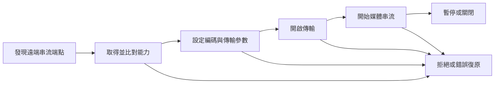

# Windows 原生 LDAC 的背景、原理與研究方法

更新日期：2026-11-01。本文是 `open-ldac-windows` 的工程研究紀錄，說明問題如何形成、採用哪些原理、目前證據可以回答什麼，以及後續應如何驗證。它不是新音訊編碼演算法論文，也未經同行審查；不宣稱已完成 Bluetooth／Sony 認證。

閱讀實作步驟請接[開發教學](DEVELOPMENT_GUIDE.zh-TW.md)，歷程與取捨見[開發紀錄](DEVELOPMENT_JOURNAL.zh-TW.md)，本輪結果見[核心驗證報告](validation/KERNEL_LAB_2026-11-01.md)。

## 摘要與問題定義

本專案研究的問題是：能否在保留 Windows 原生藍牙堆疊與現有無線電驅動的條件下，建立可驗證、可復原的 LDAC 傳輸與音訊路徑，並在音質優先的前提下控制筆電不必要的耗電？初期目標為 MediaTek 藍牙與 WH-1000XM6，但裝置相容性尚待實機驗證。

這同時涉及編碼、協定、核心物件生命週期、Windows 音訊端點與電源行為。離線編碼成功，只能證明其中一段程式能執行；即使驅動載入成功，也不能推得耳機接受 LDAC 設定、聲音正確或續航改善。本文將證據分為：

| 標記 | 定義 | 例子 |
| --- | --- | --- |
| 規格／官方介面 | 標準組織或平台擁有者定義的契約 | AVDTP、WDF 取消與回呼介面 |
| 上游實作 | 固定版本原始碼可直接檢查的行為 | LDAC 的 MDCT、量化與碼率表 |
| 廠商宣稱 | 官方產品／技術頁的性能敘述 | Sony 的最高 990 kbps 說明 |
| 本專案實測 | 記錄版本、環境、程序與結果的測試 | 合成提供者 VM 的 363 項檢查 |
| 設計／待驗證假設 | 本專案提出、尚須實驗檢驗的推論 | 事件批次能否降低整機耗電 |

## 一、從 PCM 到壓縮音訊

### 1. 取樣率、位元深度與碼率各自代表什麼

PCM 以離散數值表示每個聲道的音訊振幅。取樣率 $f_s$ 是每秒每聲道的取樣數；位元深度 $b$ 描述樣本表示的位元數，聲道數為 $C$。Windows 格式另須區分有效位元與儲存容器大小，例如有效 20 bits 可以放在 24-bit 容器。WAVEFORMATEX 定義取樣率、聲道與 block alignment；WAVEFORMATEXTENSIBLE 另外表示有效位元數。這是格式原理說明，本專案 CLI 目前仍拒絕 WAVE_FORMAT_EXTENSIBLE。[基本格式](https://learn.microsoft.com/en-us/windows/win32/api/mmeapi/ns-mmeapi-waveformatex)、[有效位元與容器](https://learn.microsoft.com/en-us/windows/win32/api/mmreg/ns-mmreg-waveformatextensible)

忽略檔頭、填補與額外容器位元，整數 PCM 的資料率為：

$$
R_{PCM}=f_s\times b\times C
$$

| PCM 範例 | 計算 | 資料率 |
| --- | --- | ---: |
| 44.1 kHz／16-bit／立體聲 | $44100\times16\times2$ | 1.4112 Mbit/s |
| 48 kHz／24-bit／立體聲 | $48000\times24\times2$ | 2.304 Mbit/s |
| 96 kHz／24-bit／立體聲 | $96000\times24\times2$ | 4.608 Mbit/s |

這些是由格式推算的數值，不是實測 Bluetooth 吞吐量。來源檔案、Windows 混音格式、編碼器輸入格式與最後的無線碼率，必須分別記錄。把 16-bit 來源放進 24-bit 容器，或將來源升頻，不能單憑格式標籤推得原本不存在的細節。

取樣率與頻寬的關係有前提：對頻帶受限、均勻取樣的理想模型，若最高頻率為 $f_{max}$，取樣頻率需滿足 $f_s>2f_{max}$，才能避免頻譜混疊並以理想方式重建。這不是「取樣率越高就必然更好聽」的定理；實際濾波、量化與播放設備仍會影響結果。[MIT Signals and Systems：Sampling](https://ocw.mit.edu/courses/6-003-signals-and-systems-fall-2011/12e6e5d7567fca2e993ef8563fef5a60_MIT6_003F11_lec21.pdf)

位元深度則描述振幅表示能力：$b$ 個二進位位元至多表示 $2^b$ 個碼值。容器有多少位元，不等於整套錄放系統實際具有多少有效解析度，也不等於壓縮後每個樣本保留相同位元數。研究報告因此應同時列出來源格式、實際處理與測量方法。

### 2. LDAC 做了什麼

**廠商宣稱：**Sony 說明 LDAC 最高可使用 990 kbps，並提供依連線條件調整的 best-effort 模式。這是技術供應者的說明，不是本專案完成的實機測量，也不能解讀成所有內容均逐位元無損。[Sony LDAC 官方說明](https://www.sony.co.jp/en/Products/LDAC/)

**上游實作：**本專案固定使用 AOSP `libldac` 提交 `eeee1a3f5f8df1282e3a6d297085885fd886737b`。原始碼可確認下列路徑：

```text
PCM 樣本
  → MDCT 轉換
  → 頻譜正規化
  → 受碼流預算限制的位元配置
  → 頻譜與殘差量化
  → 封裝為 LDAC frame
```

MDCT 把時域區塊轉為變換係數，讓編碼器以頻譜形式處理資料；量化再把係數映射到有限精度的值。量化誤差可概念化為 $e=x-Q(x)$。因此本文把此路徑視為有損編碼，不用 Hi-Res 標誌推得解碼資料與原始 PCM 必然一致。上述流程來自實際呼叫關係，沒有在此聲稱已重建完整聽覺模型或證明其感知效果。[編碼入口](https://android.googlesource.com/platform/external/libldac/+/eeee1a3f5f8df1282e3a6d297085885fd886737b/src/ldaclib_api.c)、[區塊編碼](https://android.googlesource.com/platform/external/libldac/+/eeee1a3f5f8df1282e3a6d297085885fd886737b/src/encode_ldac.c)、[量化實作](https://android.googlesource.com/platform/external/libldac/+/eeee1a3f5f8df1282e3a6d297085885fd886737b/src/quant_ldac.c)

上游 API 把品質模式與取樣率家族配對：

| 家族 | HQ | SQ | MQ |
| --- | ---: | ---: | ---: |
| 44.1／88.2 kHz | 909 kbps | 606 kbps | 303 kbps |
| 48／96 kHz | 990 kbps | 660 kbps | 330 kbps |

這是名目立體聲編碼碼率，不含全部傳輸開銷。HQ 表示該 API 的高品質設定，不是所有曲目、RF 條件與聽者都會得到較佳體驗的實驗結論。本專案已實作合法配對的手動選擇，預設 HQ，電池狀態不改變選擇。[固定版本 API 與碼率表](https://android.googlesource.com/platform/external/libldac/+/eeee1a3f5f8df1282e3a6d297085885fd886737b/inc/ldacBT.h)、[專案碼率控制](BITRATE_CONTROL.md)

### 3. 一個 frame 有多長，與延遲有什麼關係

上游定義 44.1／48 kHz 的 LDAC frame 每聲道 128 samples，88.2／96 kHz 則為 256；編碼 API 每次輸入單位仍為每聲道 128 samples。由 $T=N/f_s$ 可推得兩個取樣率家族的 frame 音訊跨度約為 2.902 ms 與 2.667 ms。這是音訊跨度的計算，**不是已量到的編碼演算法延遲或耳機延遲**；實際路徑還有內部緩衝、批次、排隊、無線傳輸與耳機播放。[上游 frame／輸入單位定義](https://android.googlesource.com/platform/external/libldac/+/eeee1a3f5f8df1282e3a6d297085885fd886737b/inc/ldacBT.h)

例如 96 kHz／24-bit PCM 與 990 kbps 的資料率比約為 $4.608/0.990=4.65$。它只描述兩個資料率的比例，不能當成音質損失比例，也不能拿來估計 RF 空中時間或耗電。

## 二、Bluetooth 音訊不是只有編碼器

### 1. 協定的分工

| 名稱 | 本研究需要理解的角色 | 不能代替的工作 |
| --- | --- | --- |
| A2DP | 定義高品質音訊分配的角色與互通要求，來源端向接收端送音訊 | 編碼器本身與 Windows 端點 |
| AVDTP | 協商串流參數、建立與控制傳輸程序 | 應用程式的完整聲音輸出介面 |
| L2CAP | 下層邏輯通道與封包傳輸介面 | LDAC 能力協商與串流狀態管理 |
| RTP | 媒體封包中的序號、時間戳等資訊 | 傳送必達、即時排程或零延遲保證 |
| AVRCP | 音訊／視訊遙控用途的設定檔 | 媒體編碼與傳輸本身 |

A2DP 與 AVDTP 的責任分工由 Bluetooth SIG 定義；AVRCP 屬另一套遙控功能。不能因為耳機的播放／暫停按鍵有反應，就推定媒體通道已完成 LDAC 協商。[A2DP 1.4 官方入口](https://www.bluetooth.com/specifications/specs/advanced-audio-distribution-profile-1-4/)、[AVDTP 1.3 官方入口](https://www.bluetooth.com/specifications/specs/a-v-distribution-transport-protocol-1-3/)、[AVRCP 官方入口](https://www.bluetooth.com/specifications/specs/a-v-remote-control-profile-1-6-2/)

Assigned Numbers 將 AVDTP 的 PSM 指定為 `0x0019`，A2DP codec ID `0xFF` 表示 vendor-specific 類別。它不直接保證遠端有特定 LDAC 能力；仍須解析供應商／codec 資訊並協商相容設定。[Bluetooth SIG Assigned Numbers](https://www.bluetooth.com/wp-content/uploads/Files/Specification/HTML/Assigned_Numbers/out/en/index-en.html)

RTP 的 16-bit 序號可協助辨識順序與遺失，32-bit 時間戳反映媒體取樣時序，不是把系統牆鐘原樣放進封包。實作必須處理回捲與正確的時間基準。本專案已有封包原語與回捲測試，但還沒有完整即時接收端行為的證據。[RFC 3550，第 5.1 節](https://www.rfc-editor.org/rfc/rfc3550.html#section-5.1)、[專案封包實作](../src/wldac.c)

### 2. 必須有狀態，而不是一直送位元組

下圖是為了說明開發順序的簡化模型，並非完整的 AVDTP 規範狀態圖：



**專案現況：**`src/avdtp.c` 只有基本單封包解析及部分命令建構。完整交易逾時、分段重組、遠端主動命令、拒絕／abort 與媒體通道協調尚待實作。能連上 PSM，不等於已完成上述程序。[原始碼與範圍](../src/avdtp.c)

### 3. LDAC 與 LE Audio 的界線

本專案目前選擇 Classic Audio 的 LDAC／A2DP 路徑。Bluetooth SIG 說明 Classic Audio 使用 Bluetooth Classic radio，而 LE Audio 使用 Low Energy radio，並引入 LC3 等不同元件。兩者不是只換一個 codec 名稱就能互通的同一條路徑；本專案也沒有實作 LC3、Auracast 或 LE Audio。[Bluetooth SIG LE Audio 說明](https://www.bluetooth.com/learn-about-bluetooth/feature-enhancements/le-audio/)

## 三、Windows 架構與核心生命週期

### 1. 為什麼還需要驅動與音訊端點

Microsoft 的原生藍牙架構容許 profile driver 經由 BthPort 等介面使用 L2CAP。這提供了傳輸入口，卻不自動把任意 codec DLL 變成一般應用程式可選的音訊裝置。本專案因此把「可取消的核心傳輸」與「音訊端點／編碼服務」分成不同工作。[Microsoft Bluetooth 堆疊](https://learn.microsoft.com/en-us/windows-hardware/drivers/bluetooth/bluetooth-driver-stack)

WaveRT 以循環緩衝等機制支援音訊串流；ACX 則把串流、格式等音訊概念納入 KMDF 類別延伸。這些官方框架是端點設計的候選依據，不能由一般 L2CAP transport 直接替代。專案尚未定案或實作端點模型。[WaveRT](https://learn.microsoft.com/en-us/windows-hardware/drivers/audio/introducing-the-wavert-port-driver)、[ACX](https://learn.microsoft.com/en-us/windows-hardware/drivers/audio/acx-audio-class-extensions-overview)

**設計取捨：**編碼器放在使用者模式，以縮小核心錯誤的範圍；核心負責有界傳輸、取消與物件壽命。未來 PCM 端點、使用者服務、AVDTP 狀態機與傳輸須共同處理背壓和停止事件。這是本專案的架構選擇，不是 Microsoft 已提供 LDAC 完整範例的宣稱。[架構決策](NATIVE_ARCHITECTURE.md)

### 2. 非同步取消為什麼不能立即釋放記憶體

WDF 的取消要求是「嘗試取消」。`WdfRequestCancelSentRequest` 的 TRUE 表示取消要求成功送往 target；完成回呼才提供該要求已退場的通知。Microsoft 也要求注意取消與完成間的參照同步。因此 cancel 回傳後立即釋放 BRB、要求內容或資料緩衝區，可能與仍在執行的路徑競爭。[WDF 取消契約](https://learn.microsoft.com/en-us/windows-hardware/drivers/ddi/wdfrequest/nf-wdfrequest-wdfrequestcancelsentrequest)

Bluetooth 的 `IndicationAddReference`／`IndicationReleaseReference` 又是另一個壽命契約：後者代表提供者不再呼叫該設定檔。CLOSE 完成、取消回傳與 callback retirement 因此不能混成同一件事。[Microsoft INDICATION_CODE](https://learn.microsoft.com/en-us/windows-hardware/drivers/ddi/bthddi/ne-bthddi-_indication_code)

本專案把檔案、OPEN、資料 I/O、CLOSE、提供者回呼及執行中的呼叫，各自視為持有者。刪除條件概念化為：

$$
\text{可銷毀}=\text{全部必要持有權已退場}\land\text{沒有執行中的存取}
$$

這是實作不變量，不是經過形式化證明的定理。根物件上限與有界保留可避免故障時無限制成長，但若提供者不退場，仍可能占住裝置與電源資源；它是錯誤隔離策略，不是已證明的節電方案。[生命週期模型](LIFETIME.md)、[原始實作](../src/lifetime.c)

## 四、研究問題與可以被推翻的假設

以下是工程研究問題；不能因為它們是設計目標，就寫成已獲證實的結果。

| 研究問題 | 假設與反證條件 | 目前狀態 |
| --- | --- | --- |
| RQ1：能否不改日用主機的藍牙綁定而驗證核心壽命？ | 合成提供者能在真實 WDF 執行關閉／取消案例；任何重複完成、晚到存取或無界保留皆反證 | VM 基準／標準 Verifier 已執行，完整故障矩陣待補 |
| RQ2：品質優先能否保持可觀察的碼率政策？ | 合法手動設定反映於後續幀；拔電不改模式；錯誤配對被拒絕 | 離線 API／CLI 已測，耳機即時狀態待測 |
| RQ3：事件批次能否減少筆電能耗？ | 在相同品質與不中斷條件下，批次策略的能量低於比較策略；若增加延遲／掉音或無能量差異，假設不成立 | 未執行整機電力比較 |
| RQ4：測試提供者的成功能否外推到真藍牙？ | 真實 BthPort 在取消／斷線／睡眠下仍滿足介面壽命條件；任何不符事件序列都要求修正 | 不能由目前資料回答 |

RQ1 的一次成功不涵蓋所有排程。RQ3 更不能由碼率降低或 CPU 下降直接推出；RF 重傳、喚醒、裝置電源狀態與使用者模式工作量可能同時改變。

## 五、品質、延遲與耗電的實驗設計

### 1. 建立因果拆解

將觀察到的總延遲概念化為：

$$
L_{total}=L_{capture}+L_{encode}+L_{batch}+L_{queue}+L_{transport}+L_{headset}
$$

這是供量測切分的模型，各項邊界必須明定，避免重複計入。編碼 frame 的跨度不能代替整體延遲。Windows 官方低延遲音訊文件也把緩衝、引擎與驅動等部分分別討論。[Microsoft Low Latency Audio](https://learn.microsoft.com/en-us/windows-hardware/drivers/audio/low-latency-audio)

批次較大可能減少喚醒，卻增加等待；buffer 太小又可能提高 underrun 風險。若平均處理能力小於資料產生速度，增加佇列只會延後壅塞，不能解決供需差距。故應使用有界緩衝及背壓，記錄佇列深度與完成速率，不以無限排隊掩蓋問題。這些是待測的系統設計推論。

電力也不只編碼 CPU。一條不能釋放的裝置參照可能影響閒置；整體電源狀態與音訊活動相關。Microsoft 的音訊電源管理文件可作觀察依據，但不提供本專案的節電數字。[官方音訊電源管理](https://learn.microsoft.com/en-us/windows-hardware/design/device-experiences/audio-subsystem-power-management-for-modern-standby-platforms)

### 2. 分階段控制變因

| 實驗層次 | 自變因 | 應固定的條件 | 指標與資料 |
| --- | --- | --- | --- |
| 離線編碼 | 來源取樣率、HQ／SQ／MQ、樣本格式 | 同一音檔、版本、編譯選項、硬體 | CPU 秒、輸出幀、錯誤、檔案雜湊 |
| 核心故障 | OPEN／CLOSE 失敗、取消時點、回呼退場次序 | 相同 SYS／PDB、可復原 VM、明確 fault site | 完成次數、根物件、IFR、Verifier 與 dump |
| 實體傳輸 | 碼率、距離、Wi-Fi 共存、批次大小 | 同耳機／韌體、PCM、音量、OS／驅動 | 協商紀錄、掉音、傳輸完成、佇列、可取得的 RF 計數 |
| 整機電力 | 同品質下的排程／批次策略 | 亮度、電池狀態、背景程式、無線條件 | 外部電力或可信電池能量、CPU／DPC／ISR、喚醒 |
| 聽感 | codec／品質設定 | 音量匹配、同曲目、隨機順序、盲測程序 | 個別試次、聽者與條件、差異及不確定性 |

先比較相同專案 pipeline 的 HQ／SQ 或排程策略，才較容易隔離單一因素。若與 Windows 原有 SBC／AAC 路徑比較，差異也包含端點、混音與驅動，應視為整體方案比較，不能全部歸因給 LDAC。

每次條件先穩定後取樣，使用成對／隨機化順序抵抗溫度與電池漂移。先導試驗用來估計變異，再決定正式樣本數與實質差異門檻；發表每次結果、失敗／排除原因、彙整方式及適用的信賴區間，不只挑最好的一次。

### 3. 指標如何計算與解讀

離線 CPU 比率是：

$$
CPU_{1core}=\frac{t_{process\ CPU}}{t_{represented\ audio}}\times100\%
$$

它是單核心等效計算量；離線程式可能遠快於即時播放，沒有真實等待、RF 或睡眠狀態。不能直接換算瓦數。電力量測則可由 $E=\int P(t)dt$ 或可信能量計數求得；若能量為 Wh、時間為 h，$\bar P=\Delta E/\Delta t$，仍須記錄量測精度與整機背景功耗。以上是量測定義，非本專案已有的電力結果。

聽感應另外驗證。可參考 ITU-R BS.1116 對音訊小損傷主觀評估的方法；本專案尚未按該建議執行實驗。若採其他盲測設計，也應公開程序與統計判準，避免把「未檢出差異」寫成「證明完全相同」。[ITU-R BS.1116-3](https://www.itu.int/rec/R-REC-BS.1116-3-201502-I/en)

## 六、本輪結果與效度限制

**本專案實測：**程式版本 `36bc35f` 在隔離 Windows VM 使用真實 WDF、合成下層提供者，基準 runner 通過 363 項檢查，回呼建立／釋放各 33 次，連線根物件銷毀 33 次。standard oneboot Verifier 的 runtime 列出目標 `OpenLdacKernelLab.sys` 與旗標 `0x001209bb`；相同 363 項檢查再通過，卸載後顯示載入 1 次／卸載 1 次。詳細 artifact、雜湊與範圍見[本輪實測摘要](validation/KERNEL_LAB_2026-11-01.md)。

標準 profile 的設定清單包含 WDF 類別 34；低資源、強制 pending I/O 與同步延遲模糊測試未選取。Verifier 本身是協助發現違規的測試工具，並非一次運行就能保證驅動沒有缺陷。[Microsoft Driver Verifier](https://learn.microsoft.com/en-us/windows-hardware/drivers/devtest/driver-verifier)

| 效度面向 | 本輪限制 | 後續處理 |
| --- | --- | --- |
| 內部效度 | 固定合成事件序列不能涵蓋全部競爭；集區統計為零也不代表所有 WDF 配置已追蹤 | 補故障站點、IRQL／多核競爭、物件與配置追蹤 |
| 建構效度 | 計數平衡不等於沒有所有晚到存取；編碼幀合法不等於聽感好 | 結合 Verifier、堆疊、物件、實體 trace 與音訊驗證 |
| 外部效度 | 合成提供者不是 BthPort；無實體 RF、PnP、耳機與睡眠行為 | 在另有復原能力的實體環境驗證 |
| 時間／效能效度 | VM 使用 NEM，除錯過程客體時鐘出現延遲／catch-up | 本輪只判斷功能與生命週期，不把 VM 用時當音訊延遲或筆電效能 |
| 重現性 | 不同 OS／WDK／編譯產物可能改變排程與符號 | 固定版本、保存 SYS／PDB 身分與完整程序 |
| 主觀與電力效度 | 尚無盲聽、瓦數、電池能量或整機續航資料 | 依預先定義的量測方案執行後再下結論 |

因此目前可支持的是「指定版本在已列出的真實 WDF／合成提供者案例與標準 Verifier profile 下完成測試」。不能擴大為真實 MediaTek／XM6 相容、正式音訊端點完成、所有故障通過，或音質／耗電已有提升。

## 七、研究過程的實務啟示

這個題目的價值不只在能否輸出 LDAC 位元流，也在於能否將需求轉為可反駁、可重現的證據。第一個核心當機來自測試驅動的 context 初始化，而非編碼器；它說明模型、靜態分析與核心執行各有覆蓋範圍，應互補使用。詳情與修正前後證據保留於[開發教學](DEVELOPMENT_GUIDE.zh-TW.md)。

音質優先也需要分成政策與結果：保留 HQ、不隨電池降級，是可檢查的產品政策；在有干擾、重傳與緩衝的實機環境中是否更好聽、更穩定，仍是實驗問題。後續研究應先完成協定與復原，再建立端點與可觀察服務，最後量測聲音及電力；每一步都保留版本與失敗案例，讓下一個開發者知道證據停在哪裡。
